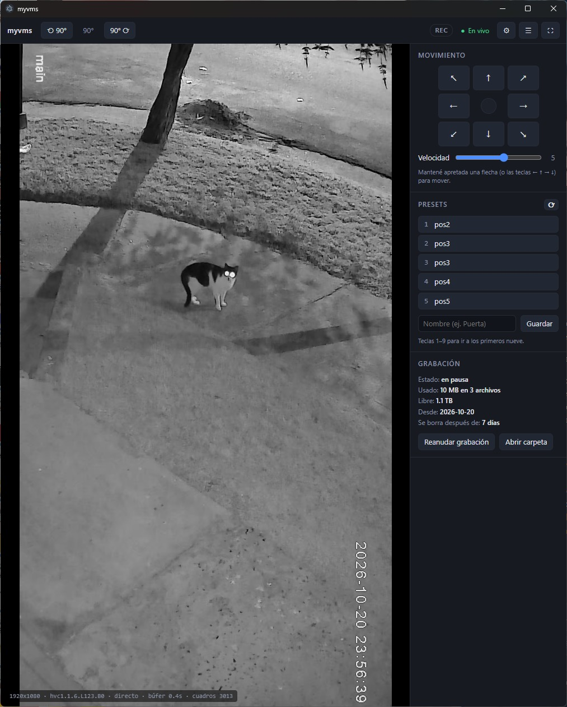

# myvms

App de escritorio para Windows para ver, grabar y mover una cámara IP Xiongmai / iCSee (PTZ).



- Video en vivo con rotación de 90°
- Movimiento de la cámara con el mouse o el teclado
- Presets: ir a una posición guardada con un clic
- Vigilancia: recorre los presets elegidos de forma automática
- Grabación continua, con borrado automático de lo viejo

## Descarga

Bajá `myvms-x.y.z-portable.exe` desde [Releases](https://github.com/evilpixi/myvms/releases/latest). No hace falta instalar nada: se abre con doble clic.

> Windows puede mostrar "Windows protegió su PC" porque el exe no está firmado. Tocá **Más información → Ejecutar de todas formas**.

## Primeros pasos

1. Abrí `myvms.exe`.
2. Tocá **⚙** y cargá la **IP**, el **usuario** y la **contraseña** de la cámara.
3. Guardá. El video aparece en unos segundos.

La contraseña queda guardada cifrada en tu usuario de Windows.

Otra opción es poner un archivo `.env` junto al exe con el usuario y la contraseña:

```
USER=admin
PASS=tu_contraseña
```

## Controles

| Acción | Mouse | Teclado |
|---|---|---|
| Mover la cámara | Mantener apretada una flecha | ← ↑ → ↓ |
| Ir a un preset | Clic en el preset | 1–9 |
| Guardar la posición actual | Escribir un nombre + **Guardar** | — |
| Rotar la vista | ⟲ / ⟳ | R / Shift+R |
| Vigilancia / manual | ◉ Vigilancia / ✋ Manual | V |
| Maximizar el video | ⤢ | M (salir: Esc) |
| Pantalla completa | ⛶ o doble clic | F |
| Mostrar/ocultar el panel | ☰ | P |

- Pasá el mouse por un preset para renombrarlo, reemplazarlo con la posición actual, reordenarlo o borrarlo.
- Con el video maximizado aparecen controles flotantes que se pueden arrastrar y contraer.
- Si la cámara se mueve al revés, cambialo en **⚙ → Movimiento**.

## Vigilancia

Marcá con ◉ los presets que querés recorrer y activá **◉ Vigilancia**. Elegí cada cuántos segundos cambia de posición y el modo:

- **↻ Ciclo:** A → B → C → A…
- **⇄ Yoyo:** A → B → C → B → A…

Mover la cámara a mano pasa a modo manual. Si cerrás la app con la vigilancia activa, sigue al volver a abrirla.

## Grabación

- Graba continuo mientras la app está abierta.
- Los videos quedan en `Videos\myvms\record_AAAA-MM-DD\`, en archivos de hasta 6 horas.
- Lo que tenga más de 7 días se borra solo (se cambia en **⚙**, igual que la carpeta).
- Se abren con VLC. El reproductor de Windows necesita la extensión HEVC.

## Para desarrolladores

Requiere Node.js 22 o superior.

```
npm install
npm start       # abrir en modo desarrollo
npm run dist    # generar el exe en dist/
```

Para publicar una versión nueva: subí la versión en `package.json` y empujá un tag `vX.Y.Z`. GitHub Actions arma el exe y lo adjunta al release.
